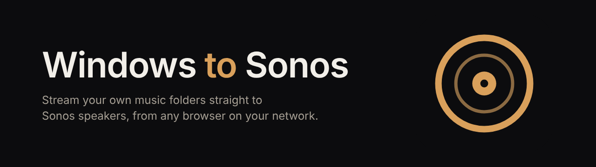
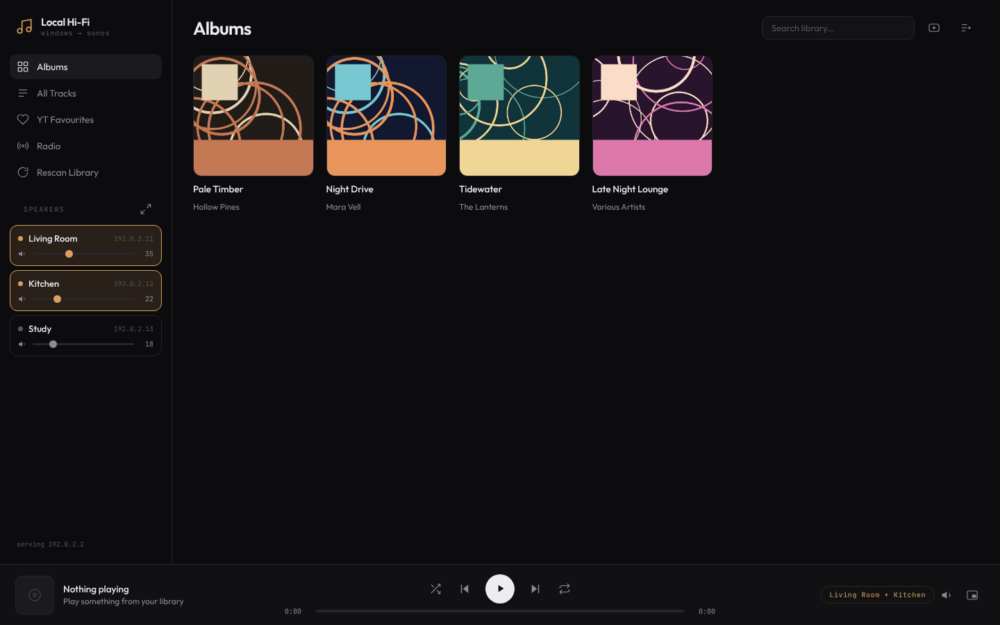
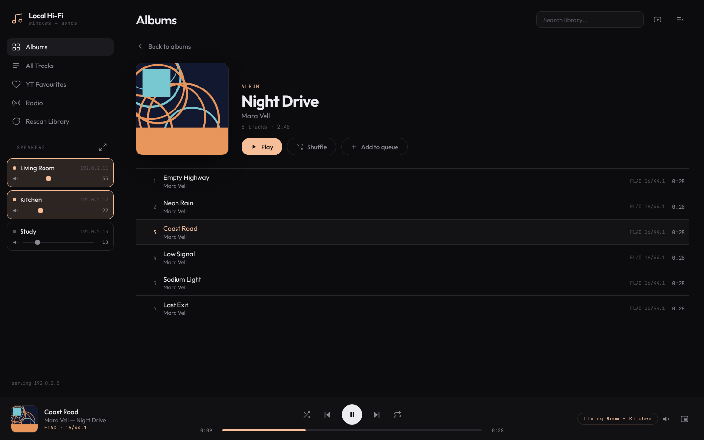
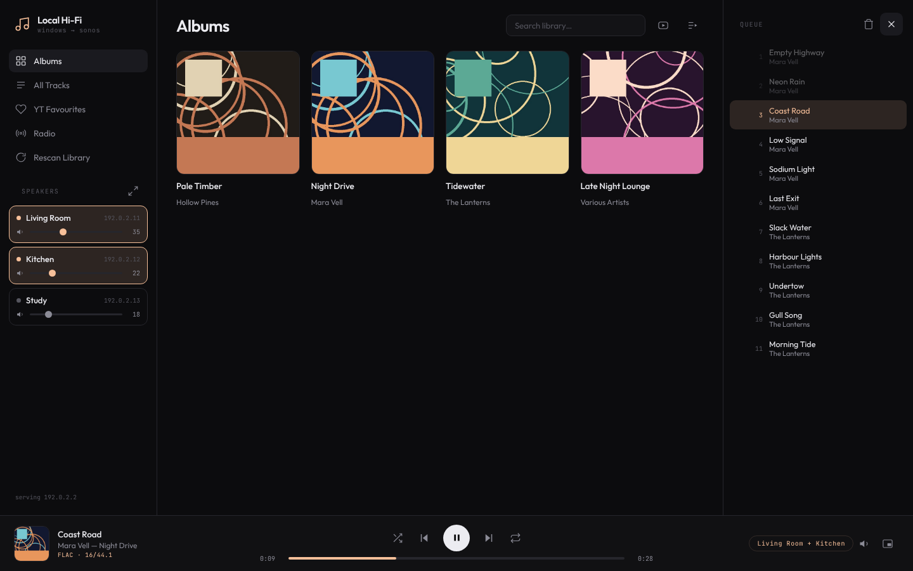
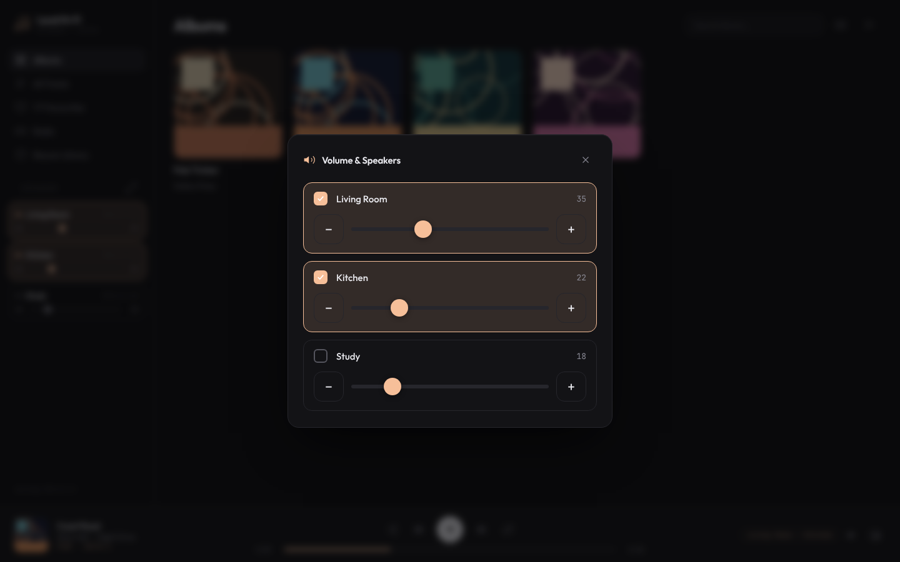

<p align="center">
  
</p>

# Windows to Sonos

Sonos can play music from a Windows PC through a network share, but that route is slow to set up and often unreliable. Windows to Sonos skips the share. It serves the music folders on your laptop, and your Sonos speakers fetch the audio from it directly.

It is a small web player for people who have Sonos speakers and a music collection on a Windows PC. Start the server on the laptop, open the page in any browser on your home network (laptop, phone or a wall-mounted tablet), and choose the speakers. The laptop only serves the files; the speakers do the playing.

It suits anyone with lossless FLAC or WAV files who does not want to convert them by hand. Files that Sonos cannot take are converted once and cached.

## What makes it different

- **Play lossless files as they are.** FLAC and WAV stay bit-perfect. Hi-res files that Sonos cannot play are converted once and cached.
- **Play without setting up a network share.** Speakers fetch audio over plain HTTP, with seeking supported.
- **Put one album in several rooms.** Select speakers to play in sync. Each speaker keeps its own volume.
- **See what is really playing.** The selection mirrors the group Sonos reports, including changes made in the Sonos app.
- **Play a YouTube video's audio without the video.** Paste a single video's link; the audio is cached for instant replay.
- **Let the cover set the colour.** The accent colour is taken from the artwork of the album that is playing.
- **Let anyone in the house use it.** There is no sign-in and no app to install: anyone on your network opens the laptop's address in a browser.

## Screenshots

| | |
|---|---|
|  |  |
| *Albums. A compilation without album-artist tags stays one album.* | *Now playing. The player bar shows the speakers in the group.* |
|  |  |
| *The queue. Drag to reorder, or remove a track.* | *Volume and speaker selection for each room.* |

## Try it in two minutes

You need Python 3.13 and a folder of music. For the YouTube feature you also need Node.js on your PATH, which yt-dlp uses to solve YouTube's JavaScript checks. The commands below were run on Linux; the Windows commands use the same steps with Windows paths.

```bash
git clone https://github.com/basvanegmond/Windows-to-Sonos.git
cd Windows-to-Sonos
python3.13 -m venv .venv
.venv/bin/python -m pip install -r requirements.txt
```

On Windows, use `py -3.13 -m venv .venv` and `.venv\Scripts\python.exe -m pip install -r requirements.txt`.

There is no build step. Before you start the server, copy the template to your own settings file (`cp config.example.json config.json`, or `Copy-Item config.example.json config.json` in PowerShell) and edit it: set `music_folders` to your music, and list your speakers with a name and an IP address. You can find the IPs in your router or in the Sonos app; reserve them in the router so they do not change. `config.json` is ignored by git, so your settings stay on your machine.

```bash
.venv/bin/python app.py
```

You should see something like this:

```
Scanning music library...
  20 tracks in 4 albums
Serving on http://192.0.2.2:8756  (open http://127.0.0.1:8756 in your browser)
```

The address after `Serving on` is your laptop on the network. Open **http://127.0.0.1:8756** on the laptop, or the same address with port 8756 from another device. Use `127.0.0.1` rather than `localhost`: on Windows, `localhost` can stall for about two seconds per request.

Speakers that are switched off show as offline, and the library still works. Choose a speaker in the sidebar, then click an album and press play.

**Windows Firewall** must let the speakers reach the laptop on port 8756, or they will stay silent. From an administrator PowerShell:

```powershell
New-NetFirewallRule -DisplayName "Windows to Sonos" -Direction Inbound `
  -Protocol TCP -LocalPort 8756 -RemoteAddress LocalSubnet -Action Allow
```

To keep the server running in the background on Windows, run `setup_autostart.ps1` once from PowerShell. It registers a Scheduled Task that starts the server at logon and restarts it if it stops.

## Troubleshooting

| Symptom | What to do |
|---|---|
| A speaker stays silent, but the track shows | Check the firewall rule above. |
| The server stops with "config.json not found" | Copy `config.example.json` to `config.json` and edit it. |
| A speaker shows as offline | Check its IP in `config.json`, and reserve it in your router. |
| New music does not appear | Click **Rescan Library** in the sidebar. |
| "Can't reach the server" in the page | The laptop is asleep, the server is restarting, or the device is off the network. |
| YouTube: "Sign in to confirm you're not a bot" | Update yt-dlp: `.venv\Scripts\python.exe -m pip install -U "yt-dlp[default]"`, then restart the server. |
| The page loads, but the server log shows a startup error | Read `logs/server.log` in the project folder. |

## How it is built

| Part | What it does |
|---|---|
| `app.py` | FastAPI server: the REST API, audio streaming with range requests, album art |
| `library.py` | Scans the music folders, reads tags, groups tracks into albums |
| `config.example.json` | Template for your own `config.json`: port, music folders, speakers |
| `sonos_ctl.py` | Controls the speakers over UPnP with SoCo: grouping, queue, playback |
| `transcoder.py` | Converts files Sonos cannot play to FLAC with ffmpeg, and caches them |
| `youtube.py` | Fetches YouTube audio with yt-dlp, caches it, keeps the favourites |
| `radio.py` | Internet radio list, stored in `radio.json` |
| `static/` | The browser UI: HTML, CSS and vanilla JavaScript, with no build step |
| `setup_autostart.ps1` | Windows only: registers the background server as a Scheduled Task |

The Python dependencies are listed in `requirements.txt`: FastAPI, uvicorn, SoCo, mutagen, imageio-ffmpeg (which bundles ffmpeg) and yt-dlp.

## Documentation

- [Architecture](docs/architecture.md): how the pieces fit, the decisions behind them, the data flow and the dependencies.
- [config.example.json](config.example.json): the settings template you copy to `config.json`.
- [LICENSE](LICENSE): the MIT licence.
- [THIRD_PARTY_NOTICES.md](THIRD_PARTY_NOTICES.md): the licences of the packages this project uses.

## Tests

There is no automated test suite yet. The app is checked by running it, as described above.

## Notes

- **Licence:** MIT, see [LICENSE](LICENSE). Use it, fork it and change it freely. The dependencies keep their own licences, listed in [THIRD_PARTY_NOTICES.md](THIRD_PARTY_NOTICES.md).
- **AI-assisted:** most of the code was written with an AI coding assistant (Claude Code) and reviewed by its author.
- **Not included:** the repository contains no music, album art or YouTube audio. The screenshots use generated tones and invented artists. Your files stay on your machine.
- **YouTube:** downloading audio from YouTube may conflict with YouTube's terms of service. Read them before you use this feature.
- **Tested with:** Sonos Arc Ultra and Era 100 speakers. Other models have not been tested.
- **Browsers:** the mini player window needs a Chromium browser such as Chrome or Edge. The interface was tested in Chromium only.
