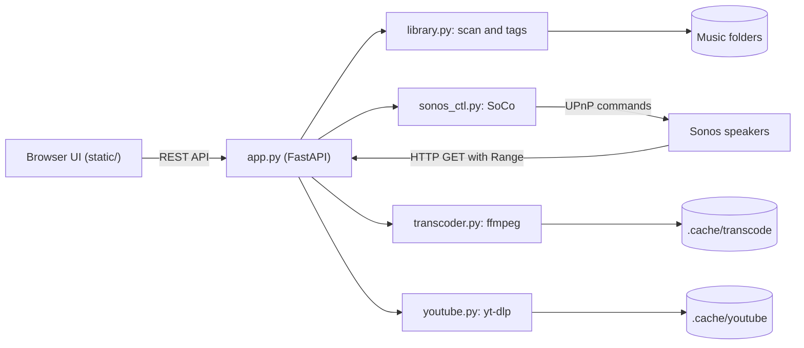
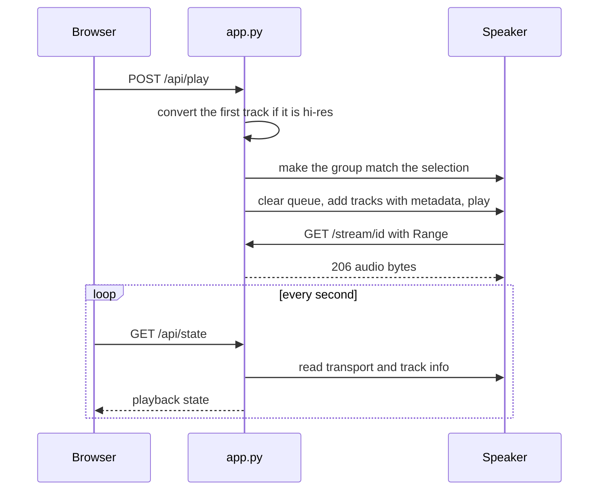

# Architecture

## Overview

Windows to Sonos is one Python process on a laptop plus a browser UI. The process does three jobs:

1. **Serves the music.** It scans your folders, and answers HTTP requests for audio files and album art. Sonos speakers fetch audio from it directly.
2. **Controls the speakers.** It sends UPnP commands (through the SoCo library) to group speakers, fill the queue, start playback, seek and change the volume.
3. **Serves the UI.** `static/` holds the whole interface as plain HTML, CSS and JavaScript. The browser talks to the process through a small REST API.

The laptop never plays audio itself. It tells a speaker what to play and where to fetch it, then keeps serving bytes.

| File | Responsibility |
|---|---|
| `app.py` | FastAPI app: REST API, `/stream` with Range support, `/art`, static hosting, start-up |
| `library.py` | Folder scan, tag reading (mutagen), album grouping, cover art lookup |
| `sonos_ctl.py` | Speaker control: grouping, queue, transport, volume, state, DIDL metadata |
| `transcoder.py` | Detects files Sonos cannot play and converts them once to FLAC, cached on disk |
| `youtube.py` | Fetches YouTube audio with yt-dlp, caches it, keeps favourites and tags |
| `radio.py` | Internet radio list stored in `radio.json` |
| `static/app.js` | The UI: library views, player bar, queue drawer, speaker selection, YouTube and radio views |

## Key decisions

| Decision | Why | Where |
|---|---|---|
| Speakers **pull** audio over plain HTTP from the laptop | Sonos plays any HTTP URL, so no network share or casting is needed. Seeking needs HTTP Range support, which FastAPI does not provide, so it is implemented by hand. | `app.py` `/stream` |
| Convert files above 24-bit or 48 kHz once, and cache them | Sonos silently refuses such files and the speaker just stays stopped. The conversion keeps FLAC, targets 44.1 kHz for the 44.1 family and 48 kHz otherwise, and runs once per track. | `transcoder.py` |
| Send every queue item with DIDL-Lite metadata and an absolute art URL | Without it the speaker shows no title, artist or cover. The track number is left out when a track has none, because the string "None" would otherwise be stored and break reading the queue back. | `sonos_ctl._didl` |
| Address playback commands to the **group coordinator** | Transport commands only work on the speaker that leads a group. | `sonos_ctl.coordinator_of` |
| Read the grouping fresh from the speakers and confirm every change | SoCo caches the topology for 5 s and refills the cache before speakers have caught up, so quick toggles acted on stale data. After a change the server waits for Sonos to confirm, and returns the group it read back. | `sonos_ctl._topology`, `form_group` |
| The UI shows the group Sonos reports, not the one it asked for | The selection follows `members` from the server, and the 15 s speaker poll adopts changes made elsewhere, such as in the Sonos app. Requests are serialised on both sides. | `static/app.js` `adoptActualGroup`, `syncGroup` |
| Hand coordination to a remaining speaker when the coordinator is deselected | Unjoining the remaining speaker empties its queue while the old coordinator keeps playing. | `sonos_ctl._take_over` |
| Read the queue straight from the speaker's ContentDirectory XML | SoCo's parser rejects a whole queue if one item has an odd value. Reading four fields from the XML survives that. | `sonos_ctl._queue_via_browse` |
| Store YouTube audio as a progressive m4a, with a JSON sidecar | YouTube serves fragmented MP4, which Sonos cannot read a duration from or seek in. The file is remuxed with the index up front and its real duration is probed. | `youtube.py` |
| Retry YouTube downloads through other player clients on a bot check | The check is made against the server's own request. The fallback clients need neither an account nor a proof-of-origin token. | `youtube._download` |
| Poll playback state once a second | The server holds no subscription to speaker events. Each poll runs on a shared pool with a 4 s limit, so one slow speaker cannot hold up requests. | `static/app.js` `pollState`, `sonos_ctl.state_with_timeout` |
| Plain HTML, CSS and JavaScript, no build step | Nothing to install or compile, and the UI is readable as shipped. | `static/` |
| Run in the background as a Scheduled Task that owns the process | A launcher that detaches gives Task Scheduler nothing to watch. The task starts `pythonw.exe` directly and re-checks every five minutes. `pythonw` has no stdout, so `app.py` points both streams at `logs/server.log`. | `setup_autostart.ps1`, `app.py` `_ensure_streams` |
| No authentication | The server is meant for a trusted home network. See the limits below. | |

## Data flow

**Start-up.** `app.py` reads `config.json`, builds the `Library` and the `SonosController`, loads the cached YouTube items, then scans the music folders. Each audio file becomes a `Track`, with an id taken from a hash of its path. Tracks are grouped into albums by album artist and album name. A folder of tracks that share an album name but have a different artist each, and no separate album artist, becomes one "Various Artists" album. uvicorn then serves the API and `static/` on `0.0.0.0` and the configured port (8756 by default).

**Playing an album.**

`/api/play` resolves the ids to tracks, converts the first track if needed and starts converting the rest in the background, makes the speakers match the UI's selection, then replaces the speaker's queue. Each queue item points at `http://<laptop-ip>:8756/stream/<id>.<ext>`. The laptop address is detected with a UDP route lookup towards a speaker and is looked up again at most every five seconds, so it follows a change of network.

**Streaming.** `/stream/<id>` finds the track by id, so only indexed files can be requested. A hi-res track is served from `.cache/transcode/<id>.flac`. A `Range` header gets a 206 response in 256 KB chunks; without one the whole file is sent with `Accept-Ranges: bytes`.

**Speaker selection.** The browser sends the selected speakers, and the server returns `{coordinatorIp, members, failed}` read back from the speakers. The selection on screen is replaced by `members`. Every play path regroups first, even with one speaker selected, so speakers left grouped from earlier do not play along.

**Queue.** The drawer reads the queue from the coordinator. Remove, move and clear call the matching UPnP actions with 0-based indexes; Sonos itself counts from 1 for moves, which `move_in_queue` accounts for. The server reads at most 500 items.

**YouTube.** `POST /api/youtube` fetches the best audio with yt-dlp into `.cache/youtube/<video_id>.m4a`, with a thumbnail and a JSON sidecar. It remuxes the file, probes its duration and registers it as a track with id `yt<video_id>`. From there it plays like any library track. Repeat requests for the same video hit the cache. Only single videos are supported.

**Radio.** A station URL from `radio.json` is handed to the speaker, which connects to the stream itself. Nothing passes through the laptop.

**What is stored where.**

| Data | Location |
|---|---|
| Settings | `config.json` (local, git-ignored; template in `config.example.json`) |
| Library index, album grouping | In memory, rebuilt on start and on **Rescan Library** |
| Converted hi-res files | `.cache/transcode/` |
| YouTube audio, thumbnails, sidecars | `.cache/youtube/` |
| YouTube favourites and their order | `youtube_favourites.json` |
| Radio stations | `radio.json` |
| Selected speakers | The browser's `localStorage` |
| Start-up errors and server warnings | `logs/server.log` |

## External dependencies

| Dependency | Used for | Licence |
|---|---|---|
| Sonos speakers | Play audio. They need UPnP on the local network and must be able to reach the laptop on port 8756. | n/a |
| [FastAPI](https://fastapi.tiangolo.com/) and uvicorn | The web server and REST API | MIT, BSD-3-Clause |
| [SoCo](https://github.com/SoCo/SoCo) | UPnP control of Sonos speakers | MIT |
| [mutagen](https://mutagen.readthedocs.io/) | Reading tags and embedded cover art | GPL-2.0-or-later |
| [imageio-ffmpeg](https://github.com/imageio/imageio-ffmpeg) | Ships an ffmpeg binary for the conversion and the m4a remux. It runs as a separate process. | BSD-2-Clause (the ffmpeg build is GPL) |
| [yt-dlp](https://github.com/yt-dlp/yt-dlp) and yt-dlp-ejs | Downloading YouTube audio and solving YouTube's JavaScript challenges | yt-dlp: Unlicense. yt-dlp-ejs: Unlicense, MIT and ISC |
| Node.js | The JavaScript runtime yt-dlp uses for those challenges. Install it separately. | n/a |
| YouTube | Source of the audio. Subject to its terms of service. | n/a |
| Internet radio streams | Fetched by the speakers directly | n/a |
| Google Fonts | The browser loads the Outfit and JetBrains Mono fonts. The UI falls back to system fonts when they are unreachable. | n/a |

## Limits

- **No authentication.** Any device on the network can control the speakers, rescan the library, and make the laptop fetch a URL through yt-dlp. Keep the port closed to anything outside the local network.
- **The laptop must be awake.** Speakers fetch each track from the laptop as they play it, so if it sleeps, playback stops.
- **Hi-res tracks cost one conversion.** The first play of a track above 24-bit or 48 kHz waits for ffmpeg; later plays use the cache.
- **Windows is the home platform.** The server also starts on Linux, but the background setup is a Windows script.
- **Browsers.** The mini player uses Document Picture-in-Picture, which needs a Chromium browser.
